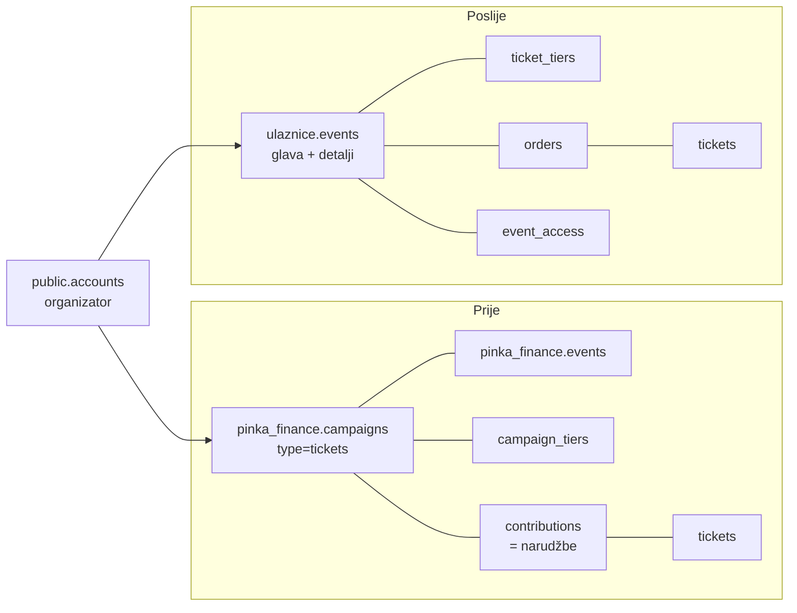

# Plan — odvajanje ulaznica iz `pinka_finance` u shemu `ulaznice`

## Zašto

Ulaznice su u 7/2026 izmodelirane kao crowdfunding kampanje (`campaigns` type `tickets`,
`campaign_tiers`, `contributions` kao narudžbe), jer je tada pretpostavka bila onchain EURe
plaćanje na Safe po kampanji. Ulaznice su u međuvremenu otišle na Stripe, besplatne i online
događaje, pa spajanje donosi rizik (migracije ulaznica mijenjaju ograničenja na kojima stoje
donacije), polja bez značenja (`goal_cents`, `chain`, `destination_address=0x0…`) i zbunjujuća
imena (`pinka-covers`). Podataka je gotovo nimalo (25. 11. 2026.: 4 eventa, 1 plaćena narudžba,
1 ulaznica), pa je prijelaz sada najjeftiniji.

## Arhitektura

Zajedničko ostaje: `public.accounts` i članstva, Auth, `pinka_finance.sanitize_ugc` (ili kopija
u `ulaznice`, odlučuje S1). Točan popis tablica i kolona je rezultat S1.

## Tvrdi uvjeti (svaka sesija)

- Nijedna sesija osim S6 i S7 ne dira produkciju; S6 i S7 tek nakon vrata.
- Isti UUID-ovi, isti HTTP ugovor `events-*` (odluke 2 i 3).
- Donacije, crowdfunding i sponzorski trenuci rade jednako prije i poslije svake sesije.
- `pinka_finance` objekti se ne brišu prije S7.

## Sesije

| # | Faza | Paket | Odluke | Gotovo kad |
| --- | --- | --- | --- | --- |
| S0 | — | Plan | 1–99 | ovaj direktorij commitan |
| S1 | F0 | Inventura, mapiranje, ciljni DDL nacrt, pitanja korisniku | 100 | `research/2026-11-*-inventura.md` s brojkama iz naredbi; pitanja na vrhu `S2.md` |
| — | vrata | Korisnik: onchain rail, rujanske migracije, dogovor s Ivanom | | odgovori upisani u `decisions.md` |
| S2 | F1 | Shema `ulaznice`, RLS, grantovi, bucket, kopija podataka | 200 | `supabase db reset` čist; novi SQL test „SVE PROVJERE PROŠLE” lokalno i nad prod dumpom; brojevi redaka jednaki |
| S3 | F1 | RPC-i narudžbi i ulaznica | 300 | SQL testovi narudžbi/ulaznica na `ulaznice` prolaze; nijedan RPC u tom dijelu ne čita `pinka_finance` |
| S3b | F1 | RPC-i organizatora i eventa | 350 | isto za organizatorske RPC-e |
| S4 | F2 | Edge funkcije `events-*` na `ulaznice` | 400 | `deno check` zelen; curl scenarij prolazi lokalno; `grep pinka_finance supabase/functions/events-*` prazan |
| S5 | F2 | `domovina-ulaznice` (worker, web, upload) + runbook produkcije | 500 | `npm test` i `web` `npm run check` zeleni; PR Ivanu otvoren; runbook u `research/` |
| — | vrata | Korisnik odobrava prebacivanje produkcije | | |
| S6 | F3 | Prebacivanje produkcije | 600 | ops-verify PASS, journal milestone, smoke test (event „Webinar” vidljiv organizatoru, besplatna narudžba na stagingu) |
| — | vrata | Korisnik odobrava brisanje starog nakon promatranja | | |
| S7 | F4 | Brisanje starog iz `pinka_finance`, dokumentacija | 700 | `grep -rn pinka_finance supabase/functions/events-*` prazan; ticketing objekti nisu u `pinka_finance`; donacijski SQL testovi zeleni; ops-verify PASS |

Procjena: 8 sesija (S1–S7 sa S3b), troje vrata. Paralelno: S4 i S5 (različiti repoi);
S3 i S3b ne (dijele migracijske datoteke i testove). Najrizičniji paketi: **S3** (rezervacije
s TTL-om, idempotencija, QR hash, refund i Stripe potvrde moraju se ponašati identično) i
**S6** (jedini nepovratni korak, uz zamrzavanje pisanja). Je li S3 prevelik za jednu sesiju,
mjeri S1 (broj RPC-a i redaka po skupini); ako jest, S1 ga dijeli prije vrata.

## Gdje smo

S0 (2026-11-25): plan napisan, koda nema.
S1 (2026-11-25): inventura u `research/2026-11-25-inventura.md` (odluke 100–107). Migracije = produkcija osim dviju iz 9/2026; podjela S3/S3b ostaje. Vrata nakon S1 prošla isti dan (odluke 110–114). Sljedeće: S2.
S2 (2026-11-25): shema `ulaznice`, bucket `ulaznice-media` i kopija podataka (`543ec66`), test 45 provjera i probni prolaz nad pravim prod dumpom (`85f3bad`); brojevi = inventura (odluke 200–210). Sljedeće: S3.
S3 (2026-11-25): RPC-i narudžbi i ulaznica, trigger inventara i `rotate_ticket_tokens` u `ulaznice` (`20261125160000`); test starog ponašanja 218 i isti scenariji nad `ulaznice` 246, grane kopije 9; ispravljen bug dvostrukog inventara (odluke 300–309). Sljedeće: S3b.

S3b (2026-11-25): RPC-i organizatora i eventa s rail gateom u `ulaznice` (`20261125170000`); test starog ponašanja 213 i isti scenariji nad `ulaznice` 251; rail gate i na tierovima nakon objave, ispravljeni bugovi allowliste, brisanja tiera, sanitizacije i `imenska` (odluke 350–361). Sljedeće: S4 (S5 paralelno).
